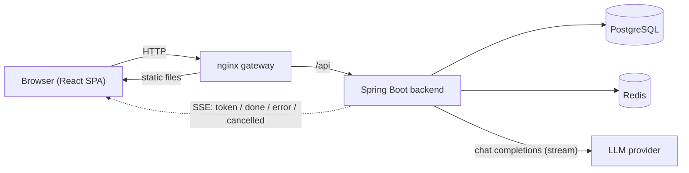

# Local RP (LRP)

[English](README.md) · [Українська](README.uk.md) · [Русский](README.ru.md)

A self-hosted web app for role-play chats with AI characters: a character catalog, a chat with real-time streamed replies and conversation branching, a character editor and generator, scoped API keys, an admin area and an owner area with encrypted backups.

> **This is a showcase repository: it contains screenshots and an overview only.**
> The source code lives in a private repository. I am happy to walk through it on a call, or to give a reviewer read access on request.

*A reply streamed to the browser over Server-Sent Events. In this demo environment the model is a small local model served by Ollama; in a normal setup the backend talks to an OpenRouter-compatible API.*

> The interface is currently **Russian only** (localization is on my list). The sample characters and dialogues in the screenshots are in English.

📖 **[Settings reference](docs/SETTINGS.md)**: every setting by category, each with a screenshot (collapsible lists).

## Highlights

**Characters**
- Catalog with avatar cards, tags, text search and tag filters (include / exclude, AND / OR)
- Character profile and editor: greeting, persona (system prompt), tags, image upload, "private prompt" and "published" switches
- Character generator form with draft autosave (character and world / RPG modes)

**Chat**
- Replies are streamed token by token (SSE); a reply can be stopped at any time
- Swipes (alternative replies), editing, regeneration and a **conversation branch tree**
- Per-chat model and "Author's Note"; a **model context view** that shows exactly what is sent to the model (character, active prompt presets, messages, approximate token counts)
- **Chat commands:** `/cmd` is a one-off director's note for the model, `/desc` asks a narrator step for a description of the scene; a command picker opens when a message starts with `/`
- Optional background generation: if the connection drops, the reply is finished on the server and the client re-attaches to it

**Accounts and API**
- Invite-only registration, roles (user / admin / root), password change, a list of signed-in devices with remote sign-out
- Personal API keys with scoped permissions (read-only, character creator, full or custom) and an optional expiry
- API documentation generated from the code, available only to the holder of an API key

**Admin area**
- Users and roles, invite codes, LLM models (default, order, on / off), an editable tag catalog (create, rename, merge, reorder) and site settings (login, registration, maintenance)

**Owner area (root only)**
- Secrets management (keys are replaced, never shown back)
- Encrypted, scheduled **backups** (age public-key encryption, a local folder and / or S3-compatible storage, retention rules with a hard space limit, verification of every backup in a temporary database, optional Telegram alerts) and **restore**
- A **first-launch flow**: a one-time setup code from the server log, creation of the owner and a six-step setup wizard

**Interface**
- Mobile-first layout with a separate mobile navigation; can be added to the home screen as an app (web app manifest)
- Every preference can be stored in the browser or on the server

## Screenshots

### Catalog and characters

| | |
|---|---|
|  |  |
| *Tag filter in the catalog* | *Character profile* |
|  |  |
| *Character editor* | *Character generator form* |

### Chat

| | |
|---|---|
|  |  |
| *Chat with swipes (1/2)* | *Per-chat model, Author's Note, branch tree, context* |
|  |  |
| *Conversation branches* | *What is sent to the model* |
|  |  |
| *`/cmd` badge and the `/desc` scene description* | *Command picker (type `/`)* |

Settings, API keys and API documentation

Every setting, one by one: [Settings reference](docs/SETTINGS.md).

Admin area

Owner area: backups, secrets, first launch

All steps of the backup wizard and of the setup wizard: [Settings reference → System](docs/SETTINGS.md#system).

Login page and mobile layout

| | | |
|---|---|---|
|  |  |  |

## Tech stack

| Part | Technologies |
|---|---|
| Backend | Java 21, Spring Boot 3, Spring Security (JWT, API keys), Spring Data JPA / Hibernate, PostgreSQL, Flyway, Redis, Server-Sent Events, OpenAPI |
| Frontend | React 19, TypeScript, Vite, TanStack Query, Zustand, React Router |
| Infrastructure | Docker, Docker Compose, nginx as the entry gateway |
| LLM access | OpenRouter-compatible chat completions API (streamed) |

## Architecture

- **Modular monolith, package by feature.** The backend is split into feature modules (auth, user, character, chat, draft, invite, media, model, api keys, site settings, secrets, backups and others).
- **Hexagonal layering inside each module:** `domain` (entities and rules), `application` (use cases and ports), `infrastructure` (REST, persistence, LLM, Redis adapters). ArchUnit tests check that the layers and modules only depend on each other in the allowed directions.
- **Database changes** are versioned with Flyway migrations.
- **Streaming:** the backend asks the LLM provider for a streamed completion and forwards it to the client as SSE events (`token`, `done`, `error`, `cancelled`). Only one generation can run in a chat at a time; the client can stop it, or re-attach to a running one after a reconnect.

## Testing

- Backend: JUnit 5, Mockito, Testcontainers (PostgreSQL), MockMvc, ArchUnit architecture tests. **Backend test coverage is partial.**
- Frontend: Vitest.

## How it was built

- The **backend architecture and the domain entities were started by me.**
- **AI coding assistants were used during development: for the frontend and to write part of the backend tests** (the backend is only partially covered by tests).

## About the demo data

Everything in the screenshots is sample data: the characters are fictional, their portraits are AI-generated, and the dialogues were written by hand. The streaming GIF is a real reply from a local model.

## Why I built it

I built Local RP for myself and to share with friends. While using SillyTavern, Character.AI and a few other online services I kept running into the same problems: an inconvenient UI/UX, especially on a phone, and, in my experience, paid plans that felt expensive for the quality of the models they offered. So I wanted a self-hosted web app that is pleasant to use from a phone (mobile-first, can be added to the home screen as an app), keeps settings in sync across devices and lets me choose the model myself.

In my opinion, it can be more convenient to use than SillyTavern. The original project also has a per-user usage balance (billing) so that friends can use it with their own limits; it is not shown in this demo.

## Plans

- Localization of the interface (Ukrainian and English; it is Russian-only now)
- More backend tests (coverage is partial at the moment) and a browser end-to-end test of the main flows
- Lorebook / world info and an automatic chat summary to keep long role-plays within the model's context
- Official support for local models (Ollama, vLLM) next to OpenRouter; the backend already works with any OpenAI-compatible endpoint
- An MCP server on top of the public API, so characters can be created and edited from AI tools
- Text-to-speech for replies
- A health / readiness endpoint for monitoring

---

© 2026 Yaroslav Andrieiev. All rights reserved. This repository contains no source code.
