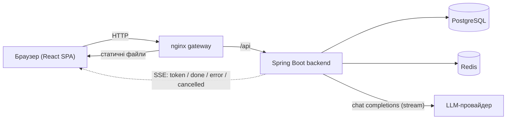

# Local RP (LRP)

[English](README.md) · [Українська](README.uk.md) · [Русский](README.ru.md)

Self-hosted вебзастосунок для рольових діалогів із ШІ-персонажами: каталог персонажів, чат зі стримінгом відповідей у реальному часі та розгалуженням діалогу, редактор і генератор персонажів, API-ключі з обмеженими правами, адмінська частина та зона власника із зашифрованими бекапами.

> **Це репозиторій-вітрина: у ньому лише скриншоти та огляд проєкту.**
> Вихідний код лежить у приватному репозиторії. Із задоволенням покажу його на дзвінку або надам рев'юеру доступ на читання за запитом.

*Відповідь, яка стрімиться в браузер через Server-Sent Events. У цьому демо-середовищі модель — невелика локальна модель через Ollama; у звичайному налаштуванні backend звертається до OpenRouter-сумісного API.*

> Інтерфейс наразі **лише російською** (локалізація є в планах). Приклади персонажів і діалогів на скриншотах англійською.

📖 **[Довідник налаштувань](docs/SETTINGS.uk.md)**: усі налаштування за категоріями, кожне зі скриншотом (списки, що розгортаються).

## Основне

**Персонажі**
- Каталог із картками та аватарами, тегами, пошуком за текстом і фільтрами за тегами (включити / виключити, AND / OR)
- Профіль і редактор персонажа: привітання, персона (системний промпт), теги, завантаження зображення, перемикачі «приватний промпт» і «опубліковано»
- Форма генератора персонажів з автозбереженням чернеток (режими «персонаж» і «світ / RPG»)

**Чат**
- Відповіді стрімляться токен за токеном (SSE); відповідь можна зупинити в будь-який момент
- Свайпи (альтернативні відповіді), редагування, повторна генерація та **дерево гілок діалогу**
- Модель і «Author's Note» окремо для кожного чату; **перегляд контексту моделі**, що показує, що саме відправляється моделі (персонаж, активні пресети промптів, повідомлення, приблизна кількість токенів)
- **Команди чату:** `/cmd` — одноразова директива режисера для моделі, `/desc` — запит до оповідача на опис сцени; перелік команд відкривається, коли повідомлення починається з `/`
- Фонова генерація (опційно): якщо з'єднання обірвалося, відповідь дописується на сервері, а клієнт знову підключається до неї

**Акаунти та API**
- Реєстрація лише за інвайтами, ролі (user / admin / root), зміна пароля, список пристроїв із віддаленим виходом
- Персональні API-ключі з обмеженими правами (лише читання, створення персонажів, повний або довільний набір) і необов'язковим терміном дії
- Документація API генерується з коду й відкривається лише власнику API-ключа

**Адмінська частина**
- Користувачі та ролі, інвайт-коди, LLM-моделі (за замовчуванням, порядок, увімкнення), редагований довідник тегів (створення, перейменування, об'єднання, порядок) і налаштування сайту (вхід, реєстрація, обслуговування)

**Зона власника (лише root)**
- Керування секретами (ключі замінюються, назад не показуються)
- Зашифровані **бекапи** за розкладом (шифрування публічним ключем age, локальна папка та / або S3-сумісне сховище, правила зберігання з жорстким лімітом місця, перевірка кожного бекапа у тимчасовій базі, необов'язкові сповіщення в Telegram) і **відновлення**
- **Перший запуск:** одноразовий код налаштування з журналу сервера, створення власника та майстер налаштування з шести кроків

**Інтерфейс**
- Mobile-first верстка з окремою мобільною навігацією; можна додати на головний екран як застосунок (web app manifest)
- Кожне налаштування можна зберігати в браузері або на сервері

## Скриншоти

### Каталог і персонажі

| | |
|---|---|
|  |  |
| *Фільтр за тегом у каталозі* | *Профіль персонажа* |
|  |  |
| *Редактор персонажа* | *Форма генератора персонажів* |

### Чат

| | |
|---|---|
|  |  |
| *Чат зі свайпами (1/2)* | *Модель чату, Author's Note, дерево гілок, контекст* |
|  |  |
| *Гілки діалогу* | *Що відправляється моделі* |
|  |  |
| *Значок `/cmd` і опис сцени `/desc`* | *Вибір команди (введіть `/`)* |

Налаштування, API-ключі та документація API

Кожне налаштування окремо: [Довідник налаштувань](docs/SETTINGS.uk.md).

Адмінська частина

Зона власника: бекапи, секрети, перший запуск

Усі кроки майстра бекапів і майстра налаштування: [Довідник налаштувань → Система](docs/SETTINGS.uk.md#система).

Сторінка входу та мобільна версія

| | | |
|---|---|---|
|  |  |  |

## Технології

| Частина | Технології |
|---|---|
| Backend | Java 21, Spring Boot 3, Spring Security (JWT, API-ключі), Spring Data JPA / Hibernate, PostgreSQL, Flyway, Redis, Server-Sent Events, OpenAPI |
| Frontend | React 19, TypeScript, Vite, TanStack Query, Zustand, React Router |
| Інфраструктура | Docker, Docker Compose, nginx як вхідний gateway |
| Доступ до LLM | OpenRouter-сумісний chat completions API (зі стримінгом) |

## Архітектура

- **Модульний моноліт, package by feature.** Backend поділений на модулі за можливостями (auth, user, character, chat, draft, invite, media, model, API-ключі, налаштування сайту, секрети, бекапи та інші).
- **Гексагональні шари всередині кожного модуля:** `domain` (сутності та правила), `application` (use case-и та порти), `infrastructure` (адаптери REST, бази даних, LLM, Redis). ArchUnit-тести перевіряють, що шари й модулі залежать один від одного лише в дозволених напрямках.
- **Зміни бази даних** версіонуються міграціями Flyway.
- **Стримінг:** backend просить у LLM-провайдера відповідь потоком і пересилає її клієнту як SSE-події (`token`, `done`, `error`, `cancelled`). У чаті одночасно може йти лише одна генерація; клієнт може зупинити її або повторно підключитися до активної після розриву.

## Тестування

- Backend: JUnit 5, Mockito, Testcontainers (PostgreSQL), MockMvc, архітектурні тести ArchUnit. **Покриття backend тестами часткове.**
- Frontend: Vitest.

## Як це створювалося

- **Архітектуру backend і доменні сутності почав я.**
- **Під час розробки використовувалися ШІ-асистенти: для frontend і для написання частини тестів backend** (backend покритий тестами лише частково).

## Про демо-дані

Усе на скриншотах — тестові дані: персонажі вигадані, їхні портрети згенеровані ШІ, діалоги написані вручну. GIF зі стримінгом — справжня відповідь локальної моделі.

## Навіщо я це зробив

Я зробив Local RP для себе та щоб ділитися з друзями. Користуючись SillyTavern, Character.AI та кількома іншими онлайн-сервісами, я постійно наштовхувався на одне й те саме: незручний UI/UX, особливо на телефоні, і, з мого досвіду, платні тарифи, що здавалися дорогими за якість моделей, які вони дають. Тож я хотів self-hosted вебзастосунок, яким приємно користуватися з телефона (mobile-first, можна додати на головний екран як застосунок), із синхронізацією налаштувань між пристроями та можливістю самому обирати модель.

На мою думку, ним може бути зручніше користуватися, ніж SillyTavern. В оригінальному проєкті також є баланс використання для кожного користувача (білінг), щоб друзі могли користуватися зі своїми лімітами; у цьому демо його не показано.

## Плани

- Локалізація інтерфейсу (українська й англійська; зараз лише російська)
- Більше тестів backend (зараз покриття часткове) і браузерний наскрізний тест основних сценаріїв
- Lorebook / world info та автоматичне підсумовування чату, щоб довгі рольові ігри вміщалися в контекст моделі
- Офіційна підтримка локальних моделей (Ollama, vLLM) поряд з OpenRouter; backend уже працює з будь-яким OpenAI-сумісним endpoint
- MCP-сервер поверх публічного API, щоб персонажів можна було створювати й редагувати з ШІ-інструментів
- Озвучення відповідей
- Health / readiness-endpoint для моніторингу

---

© 2026 Yaroslav Andrieiev. Усі права захищено. У цьому репозиторії немає вихідного коду.
