# Settings reference

[English](SETTINGS.md) · [Українська](SETTINGS.uk.md) · [Русский](SETTINGS.ru.md) · [← back to the README](../README.md)

Every setting of Local RP, grouped the way the **Settings** dialog groups them, with a screenshot of each one. Click a category to expand it.

- **Who sees what:** *Account* and *Interface* are available to every user; *Administration* to admins (site settings are read-only for them); *System* to the owner (ROOT) only.
- **Browser or server:** most personal settings have a "Browser / Server" switch, so a setting can follow your account or stay on one device.
- The interface is currently in **Russian**; the descriptions below are translated. The screenshots show sample data.

**Contents:** [Account](#account) · [Interface](#interface) · [Chat commands](#chat-commands) · [Administration](#administration) · [System](#system)

## Account

*available to every user*

<b>Persona and profile</b> — role-play name

**Role-play name (persona)**

The name that is substituted for the `{{user}}` macro in character prompts and role-play dialogues. The macro `{{char}}` is replaced with the character's name.

Control: text field with a Save button.

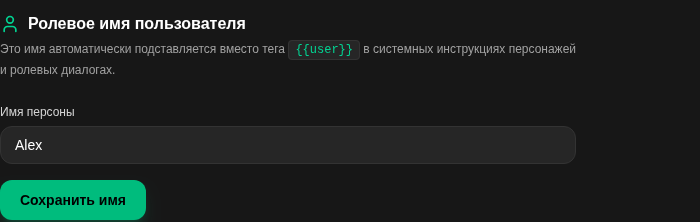

<b>Password and sessions</b> — password, signed-in devices

**Change password**

Enter the current password and a new one (at least 6 characters), then confirm the new one.

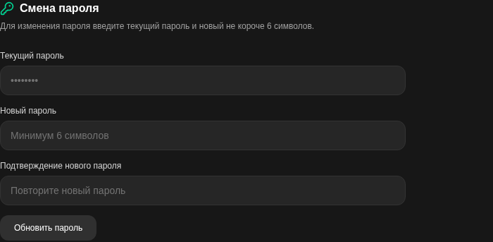

**My devices**

Shows where your account is signed in (browser and system, last activity, sign-in time) and marks the current device. A device you do not recognise can be signed out; there are also "sign out on the others" and "sign out everywhere" buttons.

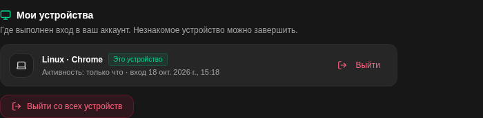

<b>API keys</b> — access for external programs

**Create a key: name, permissions, expiry**

Personal keys let external programs (bots, scripts, extensions, other chat front-ends) use your account through the API (`Authorization: Bearer <key>`). Pick a preset: **Read-only** (view characters and chats), **Character creator** (create and edit characters, upload images, no access to chats), **Full** (characters and chats, including generation) or **Custom** (tick only the permissions the integration needs: characters read / write, image upload, chats read / write and so on). An optional expiry limits the lifetime of the key. The key is shown once, right after it is created, together with a link to the API documentation (`/api/docs?key=<key>`).

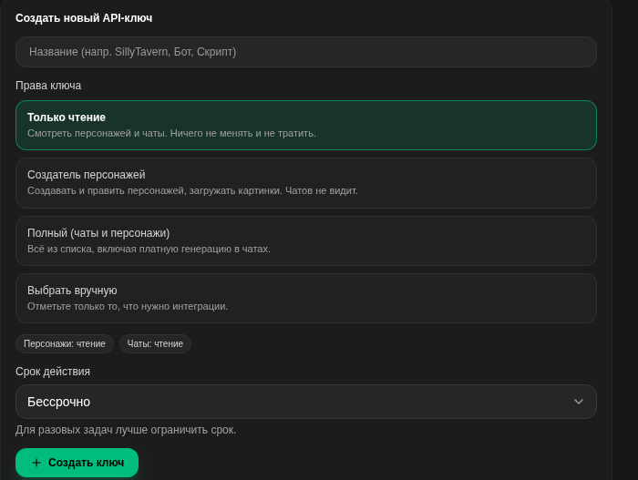

**Key list**

Every key is shown masked, with its status, permissions, creation date, last use and expiry. A key can be revoked (stops working) or deleted.

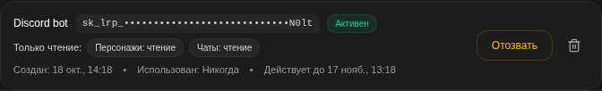

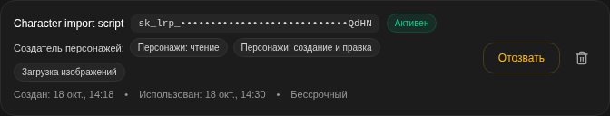

## Interface

*available to every user*

<b>Interface and chat</b> — theme, colours, background, chat view

**Where a setting is stored**

For every setting you can choose where it is stored: in the browser (local storage of this device) or on the server (follows your account). If a phone is set to "Browser" and a computer to "Server", the phone reads its own local value and does not change the scale on the computer.

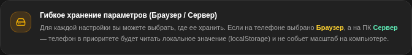

**Site wallpaper**

A background picture for the whole application: paste a direct link or upload a file from the device.

Default: none. Can be stored in the browser or on the server.

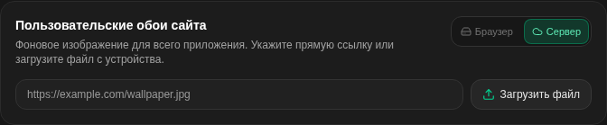

**Background blur**

Blur strength of the wallpaper, 0–40 px.

Default: 8 px. Can be stored in the browser or on the server.

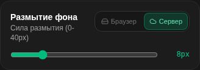

**Background dimming**

Share of the overlay on top of the wallpaper, 0–95 %.

Default: 50 %. Can be stored in the browser or on the server.

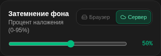

**Character art as the chat background**

Shows a blurred portrait of the current character behind the conversation.

Default: off. Can be stored in the browser or on the server.

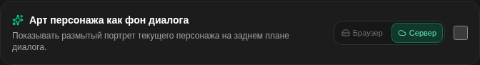

**Font size and chat scale**

Scale of messages, replies and the input field: compact (13 px), standard (15 px), large (17 px), very large (19 px), huge (22 px) and the "blind mole" mode (26 px).

Default: standard (15 px). Can be stored in the browser or on the server.

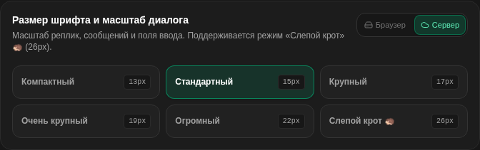

**Colour of direct speech**

Highlights the speech inside quotation marks; all common kinds of quotes are recognised (« », " ", “ ”, „ “, 「 」, 『 』, ‹ ›). A ready palette, a custom palette and "no highlight" are available.

Default: warm yellow. Can be stored in the browser or on the server.

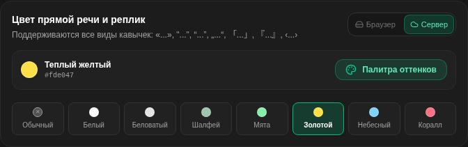

**Colour of action descriptions**

Highlights text written between asterisks, for example `*she nods*`.

Default: muted sage. Can be stored in the browser or on the server.

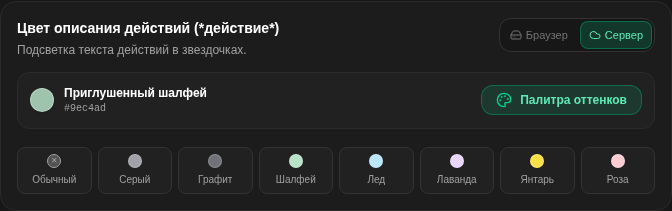

**Maximum chat width**

Width of the message column: compact (768 px), standard (896 px), wide (1152 px) or full screen.

Default: standard. Can be stored in the browser or on the server.

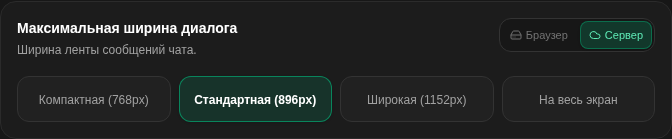

**Height of the model's thoughts block (CoT)**

Maximum height of the collapsible reasoning block before it gets its own scrollbar: compact (160 px), standard (260 px), roomy (400 px) or unlimited.

Default: standard (260 px). Can be stored in the browser or on the server.

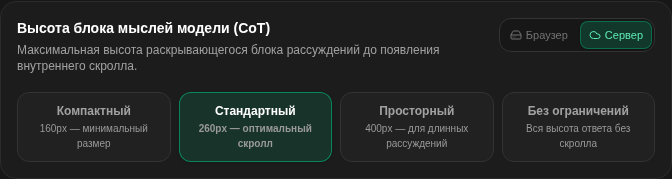

**How /cmd directives are shown**

Format in which the `/cmd` instructions inside your own messages are shown: a terminal badge, hidden completely, or as the original text. See [Chat commands](#chat-commands).

Default: terminal badge. Can be stored in the browser or on the server.

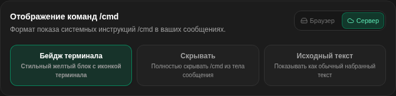

**Send hotkey**

Whether Enter sends the message at once, or Enter inserts a new line and Ctrl+Enter sends.

Default: Enter sends.

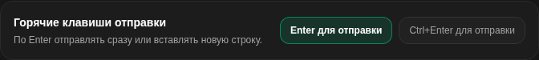

**Show message time**

Shows the exact time of sending and of generation under each message.

Default: off. Can be stored in the browser or on the server.

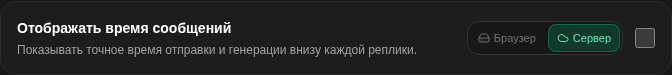

**Finish the reply even if the tab is closed**

Background generation: the reply is not interrupted when the tab is closed or the connection is lost. It is saved, and when you return to the chat (also from another device) the stream continues. The "Stop" button always stops the generation.

Default: off. Stored on the server.

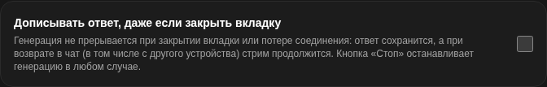

**Highlight the model context in the chat**

A checkbox in the chat menu ("Highlight context") and in the context window: messages that are sent to the model are marked in the conversation. The context window itself shows the prompt blocks and the messages with approximate token counts.

Default: off. Can be stored in the browser or on the server.

**Privacy mode**

Hides on-screen content for the moments when somebody may look at your screen: the text style (lorem ipsum, garbled text or blur), the way pictures and avatars are hidden (blur, pixelate, damage, hide) with a strength slider (default 30), and the way input fields are hidden (off, blur, dots, hide) with a strength slider (default 33). Files are not changed, only what is drawn. The parameters follow your account; the on / off switch and its hotkey live only on the current device (user menu → "Privacy mode").

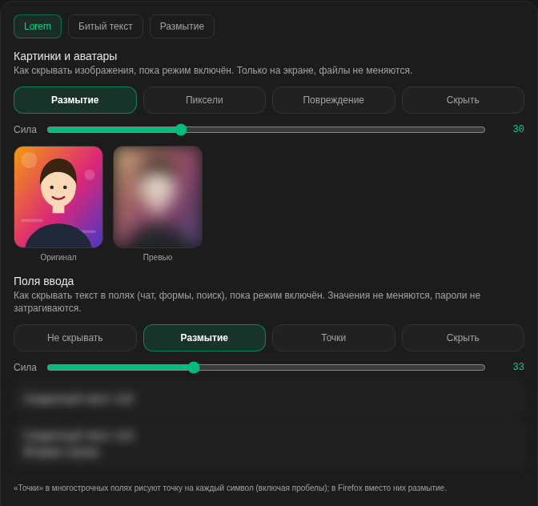

<b>Catalog</b> — how the character catalog looks and filters

**Catalog layout**

A tiled grid of cards or a compact list for quick searching.

Default: card grid. Can be stored in the browser or on the server.

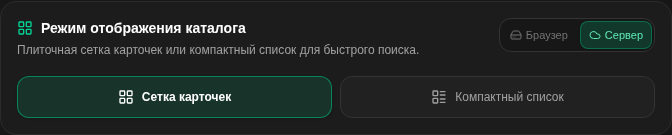

**Tag matching mode**

How several selected tags are combined in the catalog: **all tags** (a character must have every selected tag) or **any tag** (at least one match is enough). The selected include / exclude tags of the catalog sidebar are saved as settings as well.

Default: all tags. Can be stored in the browser or on the server.

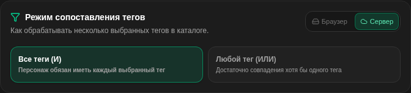

<b>AI generator</b> — models and generation parameters

**Generator model (OpenRouter id)**

Any model identifier from the OpenRouter catalog, for example `deepseek/deepseek-v3.2` or `anthropic/claude-3.5-sonnet`. The last used models are remembered as suggestions (up to 5).

Default: `deepseek/deepseek-v3.2`. Can be stored in the browser or on the server.

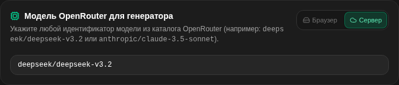

**Default narration mode**

What is generated: a specific personality (a character, companion or NPC) or a living world / text-RPG system in which the AI acts as a game master.

Default: character. Can be stored in the browser or on the server.

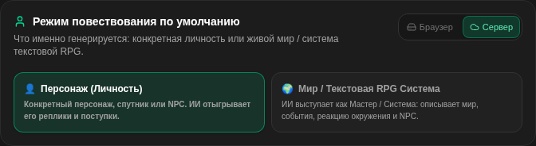

**Generation creativity (temperature)**

Higher values give less predictable and richer results. Range 0.2 (strict) to 1.1 (chaos).

Default: 0.70. Can be stored in the browser or on the server.

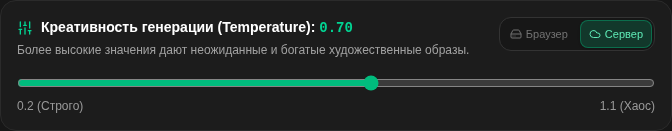

**Extra style instructions**

Your own requirements that are always passed to the generator: writing style, length of the opening, accents.

Default: empty. Can be stored in the browser or on the server.

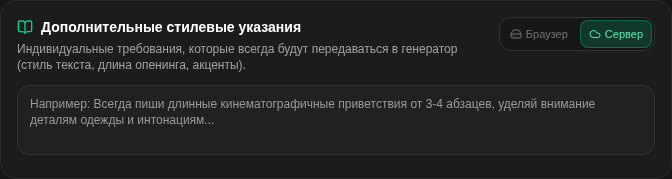

<b>Prompts and injections</b> — system instructions added to every chat

**Global prompt (for all chats)**

Applies to every conversation: writing style, preferences, restrictions. For a note that belongs to one chat only there is the Author's Note in that chat's settings.

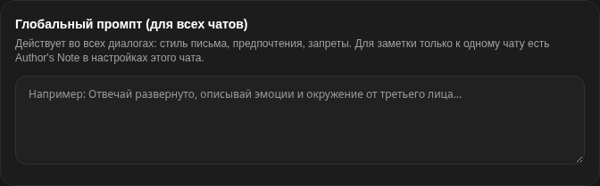

**Ready-made prompt presets**

Presets are short system instructions that can be switched on and off (the eye icon shows the exact text). They are added to the prompt after the character. A chat can also have its own list of presets. A few examples:

**Action formatting in Markdown**

Physical actions, descriptions of the body and thoughts are wrapped in asterisks, direct speech is written without asterisks or in quotes.

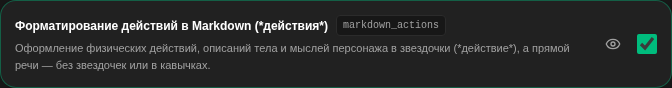

**Pace and plot development**

No standing still: every message must move the action and the character's emotional state forward.

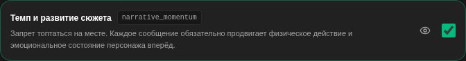

**Natural speech without clichés**

Lively modern speech without artificial archaisms, robotic phrases or misplaced foreign words.

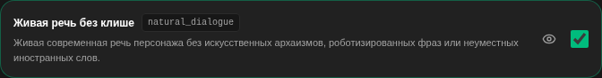

**First-person narration**

Narrate strictly in the first person ("I did...", "I feel...").

**Third-person narration**

Narrate strictly in the third person ("She came closer...", "He looked...").

**Playing NPCs and naming speakers**

Allows the AI to play secondary characters of the surroundings (NPCs) and requires it to name the person who acts or speaks.

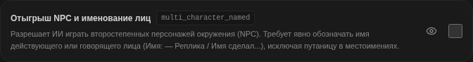

<b>Hints</b> — introduction and in-chat hints

**Introduction to the service**

A short wizard: how it works, chat commands and formatting. It can be repeated at any time.

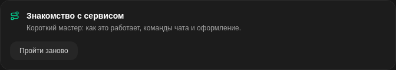

**In-chat hints**

Every hint is shown once. Reset brings them all back: the input field, swipes, the message menu.

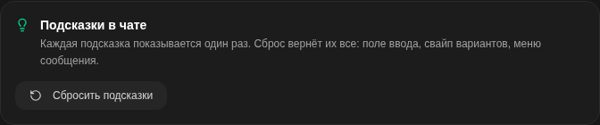

## Chat commands

*available to every user*

<b>Chat commands: /cmd and /desc</b> — directives for the model and scene descriptions

**Command picker**

Start a message with `/` to open the picker. Two commands exist; both can be used in the same message, each on its own line.

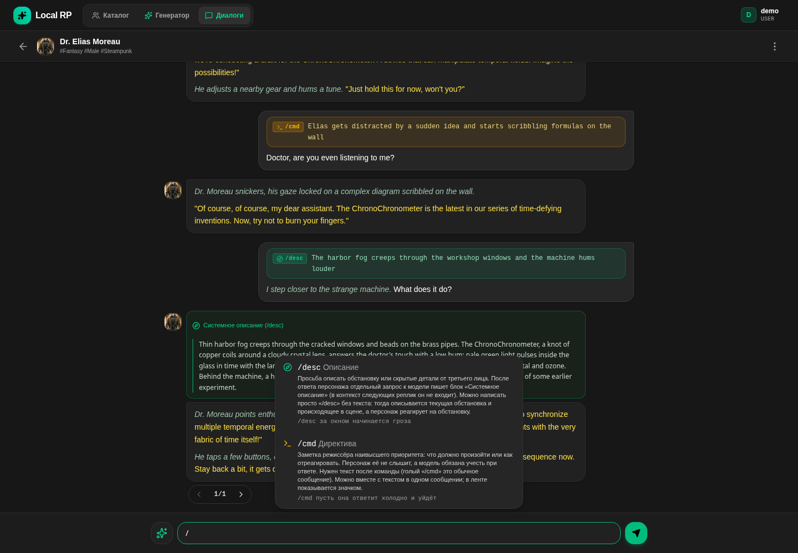

**/cmd — a director's note**

A one-off note of the highest priority for the model: what has to happen or how to react. The character does not hear it, but the model has to take it into account in this turn. The text after the command is required (a bare `/cmd` is an ordinary message). In the chat it is shown as a badge; in the history that is sent to the model the directive is cut out, so it never clutters later context.

Example: `/cmd Elias gets distracted by a sudden idea and starts scribbling formulas on the wall`.

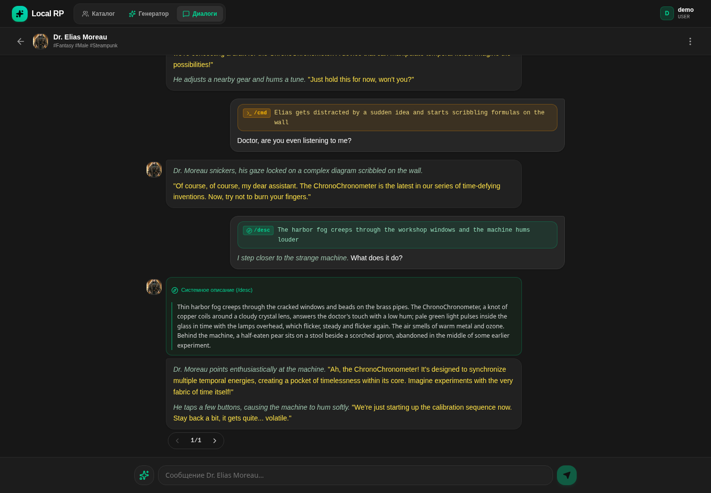

**/desc — a scene description**

Asks for a description of the surroundings or hidden details from a third-person narrator. After the character's reply a separate request to the model writes a "System description" block (it is not included in the context of the next messages). A bare `/desc` without text describes the current surroundings and what is going on, while the character reacts to the surroundings.

Example: `/desc the storm begins outside the window`.

**How /cmd is displayed**

The display mode is a setting (Interface and chat → "How /cmd directives are shown"): a terminal badge (default), hidden, or the original text.

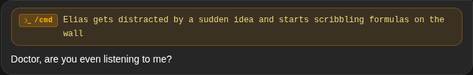

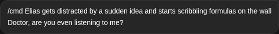

## Administration

*available to ADMIN and ROOT*

<b>Users</b> — roles, status, user card

**User list**

Search by login. Each row shows the login, the persona name, the role (USER / ADMIN / ROOT), the account status and the last activity. Roles are changed by the owner (ROOT); admins manage statuses.

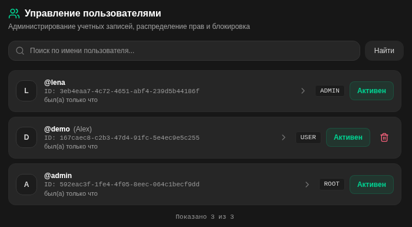

**User card**

Overview (login, role, registration and last sign-in, last activity, the invite code used) with the account status: active, suspended or banned, and a button to restore access. Other panels of the card: usage, sessions (with remote sign-out) and the journal of administrative actions.

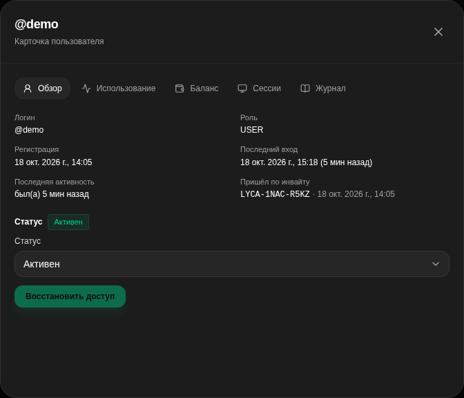

<b>Invite codes</b> — invite-only registration

**Code list**

Generation, batch creation and monitoring of invite activations. Filters: all, free, used. A used code shows who activated it and when; codes can be copied (also all active ones at once) or deleted.

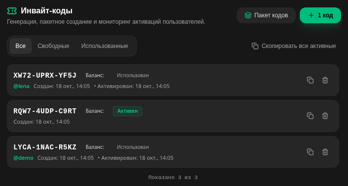

**Batch creation**

Creates several codes at once: 3, 5, 10, 20 or 50, or an exact number up to 50. A single code can also be created with the "1 code" button.

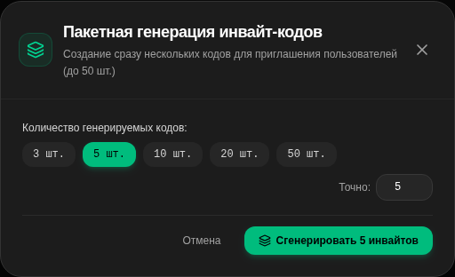

<b>Models</b> — LLM models for chats

**Connected models**

The list of models users can pick for a chat. Each model can be made the default (star), moved up or down (or dragged), switched on or off, edited or deleted.

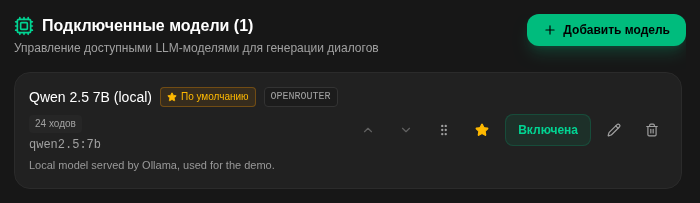

**Add a model**

Fields: name, provider, model identifier in the provider's API, maximum number of context turns, description, support for reasoning (`<think>`) and whether the model is enabled for chats immediately.

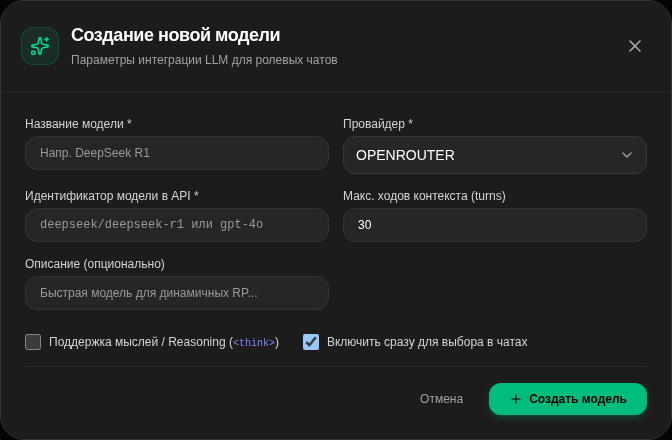

<b>Tags</b> — the tag catalog of characters

**Tag catalog**

The catalog, filters and the character form take their tags from here; the order here is the order on the site. Each tag shows how many characters use it and can be moved, hidden, merged into another tag, edited or deleted (a tag that is in use is removed from the characters only after confirmation).

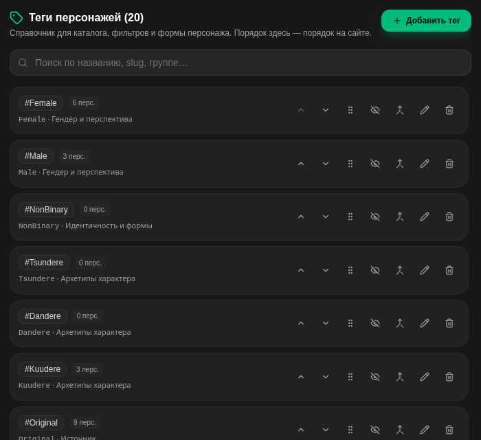

**New tag**

Name, slug (Latin letters, digits, `_` and `-`; taken from the Latin form of the name when empty and never changed afterwards), group, colour, icon, and a "hidden (service)" flag: the tag is not shown in filters and in the character form but stays on the characters that already have it.

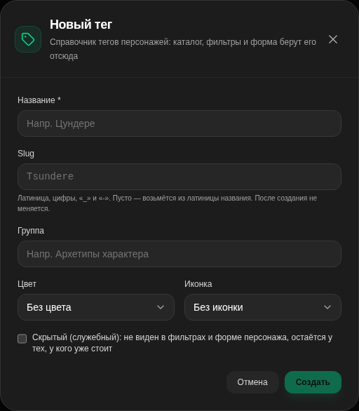

<b>Site settings</b> — sign-in, registration, maintenance, features

Visible to admins as read-only ("only ROOT can change"); the owner (ROOT) edits them. Every change is written to the journal of administrative actions.

**Sign-in allowed**

When switched off, only ROOT can sign in or refresh a session; everybody else gets the `LOGIN_DISABLED` error (access tokens that were already issued live up to 15 minutes).

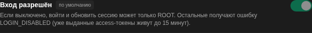

**Title of the sign-in page**

A neutral text shown on the sign-in page and in the browser tab (up to 40 characters).

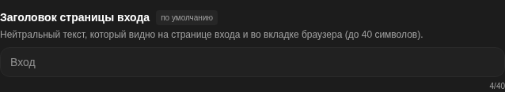

**Registration**

`invite` — registration by an invite code; `closed` — registration and invite checks are closed completely.

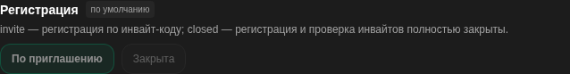

**Maintenance mode**

When on, only ROOT and ADMIN can use the application; everybody else gets a 503 `MAINTENANCE` (sign-in and the public data of the site keep working).

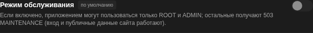

**Maintenance message**

The text users see in maintenance mode (up to 200 characters).

**Feature: generator**

Switches the character generator on or off for everybody.

**Feature: API documentation**

The documentation page is opened only with a valid API key; this switch can turn it off completely.

**Require HTTPS (owner only)**

On by default: requests that arrive over plain http (the trusted proxy says so in `X-Forwarded-Proto`) are not processed: GET / HEAD are redirected to https, other methods get 403 `HTTPS_REQUIRED`. Local addresses are not affected. Turn it off only for deployments without TLS (a local network, self-hosting).

## System

*available to ROOT (the owner) only*

<b>Secrets</b> — keys of the site: replace only, values are never shown

**OpenRouter key**

The API key used for generating replies. It is stored on the server in encrypted form and never returned in responses; a change is applied at once without a restart. Buttons: check the key and replace it. The card also shows where the current value comes from (for example, the environment).

**JWT secret**

The key that signs sign-in tokens. It is created by the server. A smooth replacement lets old sessions live until their refresh token expires; an immediate replacement signs everybody out.

**Database password**

Shown for information ("soon"): the password is needed to connect to the database itself, so changing it requires an external file and a safe procedure described in the documentation.

<b>Backups</b> — encrypted scheduled backups, restore

**Overview**

The status card (everything is fine / there is a problem) with the last backup (time, size, duration, database schema version, number of tables and rows), the next run and the schedule; buttons: make a backup now, verify, settings (opens the wizard), refresh. Below: restore, storage places with their usage against the limit, the list of archives and the run journal. Only the owner (ROOT) sees this screen; for everybody else it does not exist, neither in the interface nor in the API.

**Archives and run journal**

An archive row shows the date, the file name (`lrp-backup-<date>.tar.age`), the size, the place, the schema version, the number of tables and rows, and the verification status; actions: download, verify, restore, instructions, delete. The journal lists backups and connection checks with their results.

**Restore**

Replaces the database with the data from an archive. The archive is checked in a temporary database next to the working one, and the working database is replaced only after confirmation. The previous database is kept, so the replacement can be rolled back. An archive can also be uploaded from the computer; there is an instruction for a new server.

**Setup wizard, step 1: key**

Backups are encrypted with a public age key, so only the holder of the private key can open them. The key pair is created in the browser; only the public key is sent to the server, the private key is shown once (copy, download file or a printable recovery sheet) and the wizard makes you prove that it was saved by pasting it back (the browser derives the public key and compares it). An optional second recipient (a spare public key) lets either key open a backup. The owner's password is asked once per wizard and is not stored.

**Step 2: storage places**

Where archives go. Several places can be used at once, for example a folder on the server and a cloud bucket; the archive is encrypted, so the cloud cannot see its content, and at least one place should be on a different disk. A place is either a **local folder** (a subfolder of the backup volume) or an **S3-compatible storage** (Cloudflare R2, Backblaze B2, Amazon S3, MinIO or another): endpoint, region, bucket, prefix, access key and a write-only secret key stored encrypted. "Check connection" tries to write and reports the free space.

**Step 3: schedule**

Every day, once a week, every N hours or an advanced cron expression; time and time zone; the next runs are previewed. The schedule starts working after backups are switched on in the last step.

Default: every day at 04:00 (Europe/Prague).

**Step 4: retention and the space limit**

Per place: how many daily, weekly, monthly and labelled copies are kept (the union of them is kept, the newest copy is never deleted), an option not to delete from the storage at all (for keys without the delete permission) and a **hard space limit** in GB: the total volume of all copies, including unfinished uploads, never exceeds it, even for a second. The oldest copies are deleted first, and if a new archive does not fit, the upload does not start; the last verified copy is never deleted.

Default: 7 daily, 4 weekly, 6 monthly, 10 labelled.

**Step 5: what to copy**

The archive can contain the database (a `pg_dump`: characters, chats, users, settings), the uploaded images (avatars and card pictures), and the secrets and configuration (the master key file, `.env` and compose files; they exist only inside the encrypted archive).

**Step 6: notifications**

Optional Telegram messages: the bot token and the chat id are stored encrypted and are never shown back. Choose when to be notified: on failure, on warnings (a backup exists but with remarks, for example about the space limit), on every success, and "no backup for N hours". A test message can be sent. Without Telegram the alarms are visible on this screen only.

Default: failure and warning messages, 36 hours without a backup.

**Step 7: summary**

Shows the key fingerprint, places, schedule and contents. Every backup is verified before it is encrypted: the dump is restored into a temporary database and the tables, rows and schema version are compared, so a broken archive is never created. Buttons: "Enable and make the first backup" or "Only enable the schedule".

<b>First launch and the setup wizard</b> — one-time setup code, owner account, six-step wizard

**First launch: one-time setup code**

A new installation starts without users and without hand-written secret files (the secrets are generated automatically). While there is no user, the server prints a one-time setup code in its log (valid for 2 hours, it burns after 10 wrong attempts and a restart issues a new one), and the site shows the "First launch" page that asks for it.

**Create the owner or restore**

After the code is accepted you choose how to start: create the owner account, or restore the data and the owner from a backup archive.

**Owner account**

The login and the password of the owner (ROOT); after that the usual sign-in happens and the setup wizard opens.

**Setup wizard**

Opens right after the owner is created and can be opened again at any time: Settings → System → Setup wizard. Every step can be skipped. The code of the wizard is loaded only after the owner signs in.

**Step 1: confirm the owner's password**

The password is asked once per wizard, is kept only in memory and is needed to save keys.

**Step 2: address and HTTPS**

Shows the address you opened the site at and explains that the service itself speaks plain HTTP: encryption is provided by what stands in front of it (nginx, Traefik, a tunnel). A checkbox turns the "work only over HTTPS" setting on (recommended).

**Step 3: OpenRouter key**

All models work through this key. It is stored on the server in encrypted form and never shown in responses; "Save and check" stores it and checks it.

**Step 4: backups**

Launches the backup wizard described above; the step can be skipped and finished later in Settings → System → Backups.

**Step 5: registration**

Registration of new users: by invite code or closed.

**Step 6: final check**

A checklist (HTTPS required, OpenRouter key set, backups enabled) and a reminder to keep the private backup key separately from the server (a password manager, a flash drive): without it the backups cannot be decrypted, and the server does not store it.

